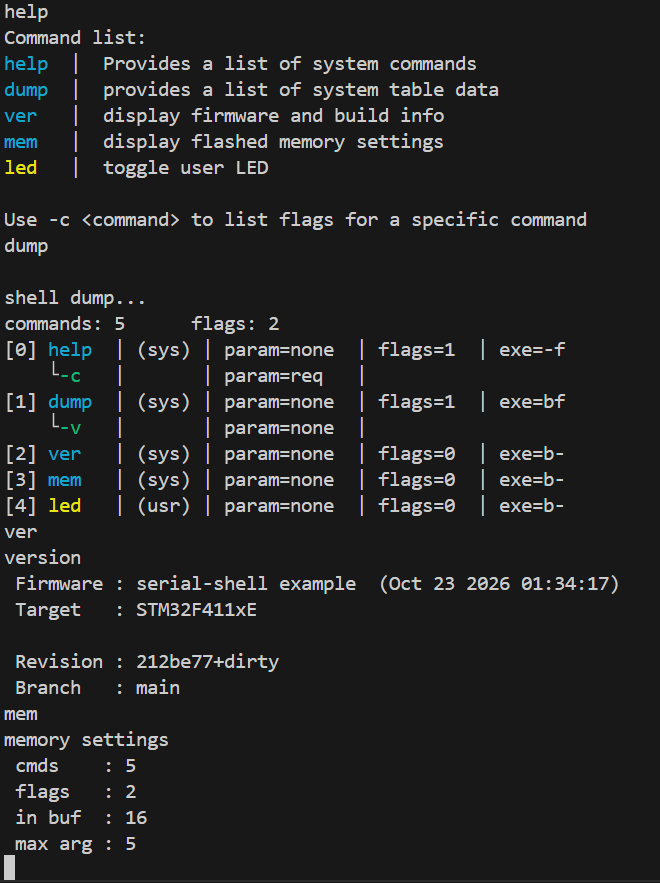

# Serial Shell

A small hardware-agnostic command line shell primarily for microcontrollers. Bytes fed to the shell are parsed and once a command is detected, the dispatcher executes the corresponding handler function.

- Only requires a character write function (i.e. `putchar()`) tied to any serial interface and a method to feed bytes into the shell
- User command table can be created using handler prototypes and passed to shell at initialization
- Several built in 'system' commands are available and can be omitted at compile time if not needed
- Includes AVR specific optimizations to store most backend text strings in `PROGMEM` to reduce RAM usage. 

<p align="center">
  
</p>

## How to Use:

Main entry point is `include/serial_shell/serial_shell.h`

A small ring buffer at `include/serial_shell/ring_buf.h` is also included as one method of feeding bytes into the shell. Use of the ring buffer with the shell is demonstrated in the provided [examples](examples/).

Minimum steps to use:
1. Include the header file `<serial_shell/serial_shell.h>`
2. Define an output callback:
```c
    void shell_putc(void* user, char c) {
        (void)user;
        my_usart_write(c);
    }
```
- Note: the user pointer is available if you have an object-based implementation for your serial interface.

3. (Optional) Define user commands / command table. See [example](examples/stm32_f411re/user_commands.c)

4. Allocate shell instance and initialize.
```c
    static shell_t my_shell;
    sh_init(&my_shell, my_commands, shell_putc, NULL, command_count);
    // or leave user `user_cmds` NULL
```

5. Feed bytes into `sh_poll()`

## Config

`include/serial_shell/config.h` includes toggleable macros to suit the needs of your project. Here you can specify buffer sizes, max supported flag count per command, and enable/disable any of the built in system commands

In addition to the configuration header, `include/serial_shell/shell_commands.h` provides typedefs for building user command/flag tables. To use custom user commands with the shell:

1. Create a command table
```c
    const shell_cmd_t my_commands[] = {...};
```
2. Write a handler function that will be called by the shell when you send your command
```c
    void cmd_led(shell_t* sh, const shell_cmd_t* self, const char* param, uint8_t argc, char **argv) {
        //turn led on...
    }
```
3. Create entries in command table
```c
    const shell_cmd_t my_commands[] = {
        {"led", "toggle led 1", cmd_led, NULL, .sub = {CMD_NO_FLAG, NOPARAM, false, 0} }
    };
```

4. Pass a pointer to your command table into shell on init
```c
    const uint8_t command_count = sizeof(my_commands) / sizeof(my_commands[0]);
    sh_init(&my_shell, my_commands, shell_putc, NULL, command_count);
```


## Built in Commands

|||                         
|----------------|-----------------------|
|`help` | lists available commands and descriptions|
|`dump` | prints detailed command/flag information (execution mode, parameter mode, etc.)|
|`ver` | firmware version and build info|
|`mem` | shell memory settings|
|`peek` | read a byte from a register (supports larger widths with -16 and -32 flags) |
|`setbit` | set a  bit in a register (requires backend implementation)|
|`rstbit` | clear a bit in a register (requires backend implementation)|

## Hooks

`include/serial_shell/hooks.h` contains implementable hooks for the register inspection commands. These are optional, only `SH_SETBIT()` and `SH_RSTBIT()` must be implemented based on your specific hardware in order to manipulate registers at runtime with the shell. The other hooks are mostly for convienience. 

## Build

Atmega2560:
- Set `AVRDUDE_PORT` COM port in `local.mk`
```make
    # local.mk
    # change to your port (COMx for Windows)
    AVRDUDE_PORT := /dev/ttyACM0 
```

```sh
    cd examples/atmega2560
    make all
    make flash
```

STM32:
- Create `local.mk` to override openocd paths. Point `OPENOCD` to the executable path and `OPENOCD_SCRIPTS` to the directory containing OpenOCD's interface and target scripts. 
```make
    # local.mk
    OPENOCD := /usr/bin/openocd
    OPENOCD_SCRIPTS := /usr/share/openocd/scripts
```

```bash
cd examples/stm32_f411re
make all
make flash
```